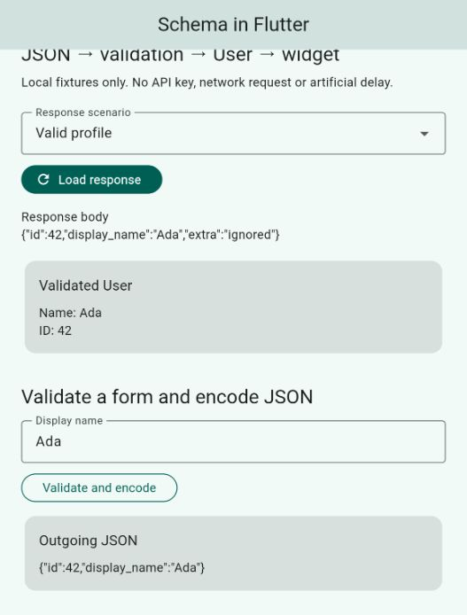

# Flutter schema example validation — 2026-10-28

## Scope

`examples/schema_flutter` is a runnable development consumer of the unpublished
local `effect_schema`. It resolves hosted `effect_core 0.0.3`. No runtime/library
implementation was changed during this example pass. The existing schema
hardening remains a separate local diff; unrelated `tool/sql_integration.py`
changes were preserved.

The app demonstrates fixture JSON → validation → explicit `User` mapping → widget,
and a name form → validation → encoded wire JSON. It includes valid data, wrong
field types, missing fields, malformed JSON and transport-failure fixtures.
Unknown backend fields are stripped intentionally. No Node sources or generated
Flutter JavaScript builds are tracked. The app is excluded from the core archive
and is analyzed independently from the core package.

## Findings fixed in the example

- An immediately failing Future could report an unhandled error before
  FutureBuilder attached during a reload. The repository now handles transport
  exceptions immediately and returns typed loaded/invalid/request-failed results.
- Result cards now expose both their heading and full field details to assistive
  technology, with live announcements, rather than announcing only the heading.
- Future creation happens outside build. Repository replacement reloads; stale
  completions cannot overwrite a newer response. Text controllers are disposed.
  Editing a form clears stale encoded output.

## Executed checks

| Check | Result |
| --- | --- |
| Flutter / Dart SDK | Flutter 3.47.0 / Dart 3.13.0 |
| Flutter analyzer | No issues |
| Flutter tests on VM | 12 passed |
| Flutter tests in Chrome | 12 passed |
| Web release build | Passed |
| macOS release build | Passed, 41.7 MB app |
| Running web UI | Valid profile, invalid field paths and JSON encoding inspected |
| macOS release smoke test | Launched, rendered validated profile, encoded JSON; app then closed |
| Root Dart analyzer / diff whitespace | Passed |
| Isolated schema candidate checker | Analyzer, 22 tests, example, zero-warning publish dry run passed |
| Shared skill index / entrypoint validators | Refreshed / passed |

The 12 tests cover accessibility labels, typed model round trips, exactly one
initial load despite rebuilds, wrong field types, missing field, malformed JSON,
request failure/recovery, form errors and encoding, stale completion ordering,
late error after unmount, repository replacement and 360px/2× text layout.

Xcode emitted a device build-number diagnostic, but the macOS release build and
launch succeeded. A missing Cupertino font warning in the first web build was
resolved by declaring `cupertino_icons`, and the final web build included both
Material and Cupertino font subsets. Flutter's Wasm dry run is not a Wasm runtime
acceptance result.

The initial accessibility test leaked its own semantics handle through late test
teardown; the test now releases that handle in `finally` before Flutter's end-of-
test verification. Final suites pass.

## Reproduce

From `examples/schema_flutter`:

```sh
flutter pub get
flutter analyze
flutter test
flutter test --platform chrome
flutter build web
flutter build macos
flutter run -d macos
```

`lib/previews.dart` adds valid/error Widget Preview annotations; the previewer
itself was not separately launched. See the example README for the data flow,
request ownership boundaries and real-backend adaptation.



## Limits

Fixtures do not exercise a live HTTP service. FutureBuilder's stale-result
protection does not cancel transport work; production transports must provide
cancellation/ownership and response-size limits separately. This example has no
network client or timers to close. Validation stays synchronous and large data
can still block the UI isolate. This run does not add memory-soak, frame-time,
physical-device, iPad, simulator or live-provider acceptance. No package was
published and no hosted website was deployed. `effect_config` remains the next
package in the agreed implementation order.
